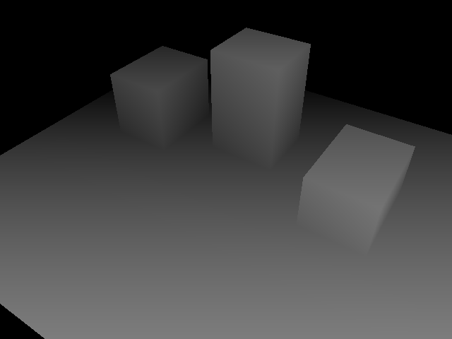

# GeoCam — 3D Scene & Synthetic Data Simulator

> **Blender + Python 기반 소형 3D 합성데이터 생성 프로젝트**  
> A compact Python-driven 3D scene, camera and synthetic sensor-data pipeline.

GeoJSON에 정의된 건물·도로의 위경도를 지역 좌표로 변환해 Blender 장면을 자동 생성하고, 서로 다른 **3개 카메라 시점**에서 **RGB, Depth, Semantic Segmentation**을 출력합니다. Pinhole 카메라 투영 계산, 예시용 Depth 센서 노이즈, PyTorch 데이터 로더를 포함합니다.

이 프로젝트는 대규모 도시 복원이나 완성된 물리엔진보다 **3D Scene 생성·렌더링 자동화와 센서 데이터 생성**에 집중한 소규모 구현입니다.

## 1. Results

다음 이미지는 동일한 데모 장면의 DAY 1 RGB와 DAY 2 Depth·Segmentation 미리보기입니다. **DAY 3의 3개 시점 결과와는 별도의 실제 실행 샘플**입니다.

| RGB | Depth preview | Semantic Segmentation preview |
|:---:|:---:|:---:|
|  |  |  |

**DAY 3 실행 결과 (Blender 4.5.14 LTS, Windows):**

- 카메라 위치 **3개** (`view_01`, `view_02`, `view_03`)의 렌더링 완료
- 각 시점별 RGB, Depth EXR, Segmentation ID PNG, 노이즈 Depth NPY 및 메타데이터 생성
- Pinhole 투영 계산 vs. Blender `world_to_camera_view` 비교: **0.000007 / 0.000017 / 0.000011 px** (3개 시점)
- PyTorch Loader에서 **RGB `[3, 480, 640]` float32**, **마스크 `[480, 640]` int64**, 클래스 ID **0·1·2** 확인

> 위 투영 오차는 **동일한 3D 점에 대한 구현 간 계산 일치도**입니다. 실물 카메라의 보정 정확도 또는 실제 센서의 측정 정확도를 의미하지 않습니다.

## 2. Key features

| 모듈 | 직접 구현하거나 제어한 기능 | 파일 |
|---|---|---|
| Geographic Scene | 작은 영역에 대한 위경도 → 동/북 방향 미터 좌표 근사 변환, 건물·도로 Mesh 생성 | `main.py` |
| Rendering Pipeline | Blender Cycles Z / Object Index Pass를 활용한 RGB·Depth·클래스 마스크 출력 | `day2.py` |
| Camera Simulator | 카메라 시점 3개, Pinhole 내부 파라미터, 3D→2D 픽셀 투영 비교 | `day3.py`, `sensor_math.py` |
| Depth Noise | 거리별 표준편차를 적용한 Gaussian noise와 결측값을 시뮬레이션 | `sensor_math.py` |
| ML Input | RGB·Segmentation 쌍을 PyTorch 텐서로 변환하고 2/1개로 분할하는 데모 | `dataset_loader.py` |

### Ground-truth class labels

Blender 객체의 `pass_index`를 사용하여 픽셀별 정답 클래스 ID를 생성합니다.

| ID | 클래스 |
|---:|---|
| 0 | Ground / Background |
| 1 | Road |
| 2 | Building |

RGB와 ID 마스크는 동일한 카메라 위치·해상도에서 출력됩니다. `segmentation_ids.png`는 **숫자 라벨 데이터**, `segmentation_preview.png`는 **확인용 컬러 이미지**입니다.

### Depth output

- `depth.exr`: Blender Z Pass의 부동소수점 깊이값 원본
- `depth_preview.png`: 깊이를 회색으로 변환한 **시각화** (원본 수치 보존용 아님)
- `depth_noisy.npy`: 원본 깊이에 간단한 랜덤 노이즈·결측을 적용한 NumPy 배열 (결측값은 `NaN`)

노이즈 모델은 **실제 카메라 사양으로 보정된 모델이 아닌 실습용 근사 모델**입니다. 장면의 공간 단위는 미터로 가정합니다.

## 3. Processing flow

```text
sample_map.geojson
      │
      ▼
Python: local geographic coordinate conversion
      │
      ▼
Blender (bpy): building / road / camera scene
      │
      ▼
Camera views 01–03 + Cycles render passes
      │
      ├── RGB .png
      ├── Depth .exr  ──► illustrative noisy depth .npy
      ├── Class-ID mask .png
      └── Camera metadata .json
                 │
                 ▼
       PyTorch Dataset Loader
```

## 4. Development environment

- **OS:** Windows 11 (실행 확인 환경)
- **Blender:** 4.5.14 LTS (Cycles)
- **Languages:** Python (`bpy`, 표준 라이브러리)
- **Dataset libraries:** NumPy, Pillow, PyTorch (Blender 바깥에서 실행)
- **Render resolution:** 640 × 480

`sample_map.geojson`의 지형은 **실제 건물을 재현한 데이터가 아니라 테스트용 합성 GeoJSON**입니다. 좌표 변환도 좁은 영역을 가정한 equirectangular 근사 방식으로, 측량급 정확도를 제공하지 않습니다.

## 5. Run

### A. Blender에서 합성데이터 생성

1. 저장소를 다운로드하거나 clone합니다.
2. Blender 실행 → **Scripting** → **Open** → `day3.py` 선택
3. **Alt + P** (Run Script)
4. **Window → Toggle System Console**에서 성공 로그 확인

```text
[GeoCam DAY 3] SUCCESS - all 3 viewpoints completed
```

**Windows PowerShell에서 Blender를 직접 실행**하려면 (설치 경로에 맞게 수정):

```powershell
cd "C:\path\to\GeoCam"
& "C:\Program Files\Blender Foundation\Blender 4.5\blender.exe" --background --python-exit-code 1 --python day3.py
```

DAY 1만 실행하려면 `main.py`, DAY 2 렌더링만 실행하려면 `day2.py`를 Blender에서 실행할 수도 있습니다. `day3.py`는 필요한 이전 단계를 내부에서 다시 호출합니다.

### B. PyTorch로 결과 불러오기

렌더링이 끝난 뒤 **일반 PowerShell / Python 환경**에서 실행합니다. Blender에 PyTorch를 설치할 필요는 없습니다.

```powershell
python -m pip install -r requirements.txt
python dataset_loader.py
```

실제 실행 확인 예시:

```text
[Dataset Loader] SUCCESS
Samples: 3 train: 2 val: 1
RGB  : (3, 480, 640) torch.float32 range: [0,1]
Label: (480, 640) torch.int64 IDs: [0, 1, 2]
```

3개 샘플 분할은 **데이터 로딩 시연**일 뿐이며, 모델을 실제 학습·평가한 결과가 아닙니다. 세 데이터는 같은 장면의 다른 시점이므로 독립적인 학습/검증 성능 평가에 적합하지 않습니다.

### C. 순수 Python 단위 테스트

```powershell
python -m unittest test_sensor_math.py
```

Pinhole 투영, 노이즈 재현성·결측, NPY 배열 방향을 확인합니다.

## 6. Project structure

```text
GeoCam/
├── main.py                 # GeoJSON → 3D Scene → 기본 RGB
├── day2.py                 # Cycles, Depth, Segmentation
├── day3.py                 # 3개 시점 / Camera Metadata
├── sensor_math.py          # Pinhole / Depth Noise / NPY
├── dataset_loader.py       # PyTorch Dataset 데모
├── test_sensor_math.py     # Unit tests
├── sample_map.geojson      # Synthetic example input
├── requirements.txt        # Dataset Loader dependencies
├── docs/                   # Sample render previews
└── output_day3/            # 실행 시 생성 (Git 관리 제외)
    ├── view_01/
    │   ├── rgb.png
    │   ├── depth.exr
    │   ├── depth_preview.png
    │   ├── class_ids.exr
    │   ├── segmentation_ids.png
    │   ├── segmentation_preview.png
    │   ├── depth_noisy.npy
    │   ├── depth_noisy_preview.png
    │   └── metadata.json
    ├── view_02/
    └── view_03/
```

## 7. Scope & limitations

- 간단한 **3D Scene·센서 데이터 생성 데모**이며 도시 단위 시뮬레이터가 아닙니다.
- 카메라는 **Pinhole만 구현**했습니다. Fisheye, 자체 물리엔진, 강화학습은 포함하지 않습니다.
- Segmentation은 3개 클래스, 렌더링은 동일 장면의 3개 시점으로 제한합니다.
- 실제 RGB/Depth 센서와의 정량적 비교 및 실세계 일반화 성능 검증은 수행하지 않았습니다.
- 출력 파일이 정상 생성되는 것을 확인했지만, 대규모 데이터셋 품질을 보증하는 프로젝트는 아닙니다.

## 8. Technical notes

1. **Renderer:** Object Index Pass(`IndexOB`) 출력이 필요해 Blender 4.5에서 Cycles 사용.
2. **Camera convention:** Blender 카메라의 로컬 `-Z`가 전방, `+Y`가 위쪽. 투영 시 오른쪽·위쪽·전방 좌표로 변환.
3. **Reproducibility:** 노이즈는 고정 seed를 사용. Blender 씬 구성은 샘플 GeoJSON에 의해 결정.
4. **Validation:** 위의 수치적 투영 비교 외에 원본 Depth vs 노이즈 Depth의 실센서 정합성 검증은 포함하지 않음.

---

**Project type:** Job-role-inspired personal portfolio / synthetic data generation prototype.
