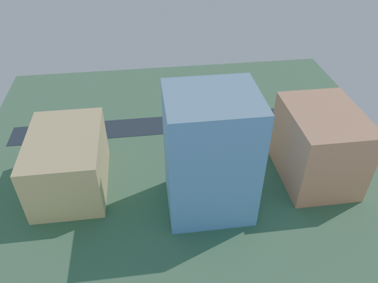
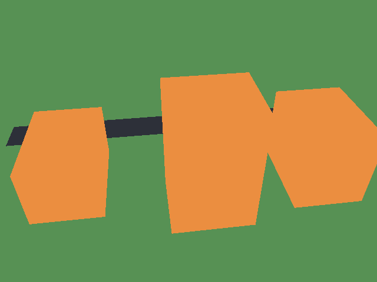
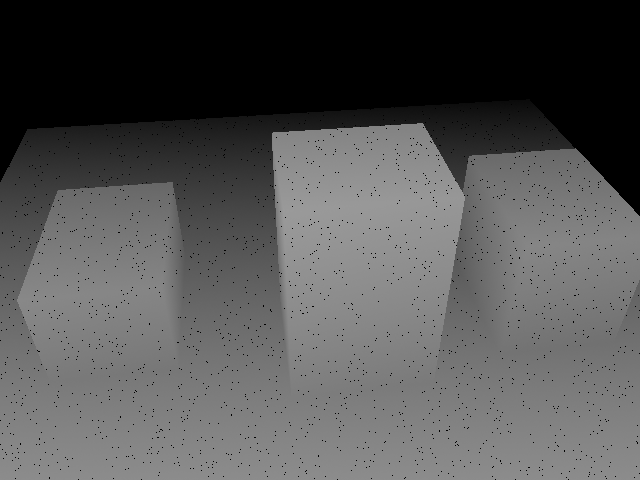
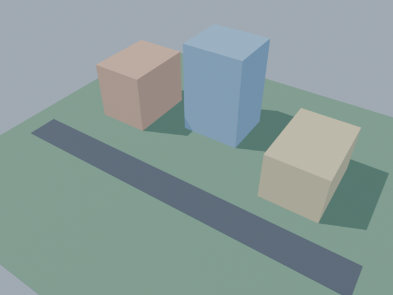

# GeoCam — 3D Scene & Synthetic Data Simulator

> Blender와 Python으로 구현한 소규모 3D 장면 및 합성 센서 데이터 생성 파이프라인  
> A lightweight Blender–Python pipeline for 3D scene generation and synthetic vision data.

GeoCam은 **GeoJSON 좌표를 기반으로 3D 장면을 자동 생성**하고, 서로 다른 카메라 시점에서 **RGB·Depth·Semantic Segmentation 데이터**를 출력하는 프로젝트입니다. Python으로 Blender의 장면 생성과 렌더링을 제어했으며, Pinhole 카메라 투영 계산, 간단한 Depth 센서 노이즈 모델, PyTorch 데이터 로더를 구현했습니다.

실제 도시를 정밀하게 복원하기보다는 **장면 생성 → 카메라 설정 → 렌더링 → 학습용 데이터 로딩**으로 이어지는 기본 파이프라인을 구현하는 데 초점을 맞췄습니다.

## 1. Results

### Synthetic data from a single viewpoint

아래 이미지는 같은 장면을 **동일한 카메라 시점**에서 출력한 결과입니다. RGB와 클래스 마스크, 원본 Depth와 노이즈가 적용된 Depth를 비교할 수 있습니다.

| RGB | Semantic Segmentation |
|:---:|:---:|
|  |  |

| Clean Depth | Noisy Depth |
|:---:|:---:|
|  |  |

- **RGB:** Blender의 가상 카메라로 렌더링한 컬러 이미지
- **Semantic Segmentation:** 객체별 클래스 ID를 색상으로 표시한 미리보기. 실제 정수 라벨은 `segmentation_ids.png`에 저장
- **Clean Depth:** Cycles Z Pass에서 생성한 Depth(`depth.exr`)를 보기 쉽게 표현한 이미지
- **Noisy Depth:** Depth에 거리 의존 Gaussian 노이즈와 일부 결측값을 적용한 결과. 수치 데이터는 `depth_noisy.npy`에 저장

Depth 미리보기는 시각화를 위한 PNG이며, 실제 깊이값은 EXR·NPY 파일에 보존됩니다. 노이즈 모델은 특정 실물 센서를 보정해 재현한 것이 아닌 **간단한 시뮬레이션 모델**입니다.

### Multi-view rendering

`day3.py`는 카메라 한 대의 위치와 자세를 순차적으로 변경해 **3개 시점**(`view_01`~`view_03`)의 데이터를 자동 생성합니다. 각 시점의 RGB, Depth, Segmentation 및 메타데이터는 `output_day3/view_XX/`에 저장됩니다.

아래는 개발 초기의 RGB 출력과 DAY 3의 RGB 출력입니다. **서로 다른 개발 단계의 예시**로, 렌더러와 조명 조건을 통제한 비교 실험은 아닙니다. DAY 3의 다른 두 시점 이미지는 현재 저장소에 별도로 게시하지 않았습니다.

| DAY 1 — initial render | DAY 3 — sample render |
|:---:|:---:|
|  |  |

### Execution results

Windows 11, Blender 4.5.14 LTS에서 실행한 결과입니다.

| 항목 | 결과 |
|---|---|
| 다중 시점 렌더링 | **3개 시점 모두 완료** |
| 시점별 출력 | RGB, Depth EXR, Segmentation 마스크, Noisy Depth NPY, 카메라 메타데이터 |
| Pinhole 투영 계산과 Blender 비교 | `view_01`: **0.000007 px**, `view_02`: **0.000017 px**, `view_03`: **0.000011 px** |
| PyTorch Dataset Loader | **3개 샘플 로딩 성공** (Train 2 / Validation 1 분할 시연) |
| 텐서 형식 | RGB: `float32 [3, 480, 640]`, 마스크: `int64 [480, 640]`, 클래스 ID `0, 1, 2` |

투영 오차는 **각 시점에서 하나의 3D 점**을 선택해 직접 구현한 투영 수식과 Blender의 계산 결과를 비교한 값입니다. 실제 카메라 정확도를 측정한 수치는 아닙니다.

## 2. Key features

| 구성 요소 | 구현 내용 | 주요 파일 |
|---|---|---|
| **Geographic Scene** | 위경도를 지역 미터 좌표로 근사 변환하고 건물·도로 Mesh 자동 생성 | `main.py` |
| **Rendering Pipeline** | Blender Cycles의 Depth(Z)·Object Index Pass를 이용한 데이터 출력 | `day2.py` |
| **Camera Simulator** | 3개 시점 렌더링, Pinhole 내부 파라미터 계산, 3D→2D 투영 비교 | `day3.py`, `sensor_math.py` |
| **Depth Noise Model** | 거리별 Gaussian 노이즈와 일부 측정 실패값 시뮬레이션 | `sensor_math.py` |
| **Dataset Loader** | RGB·Segmentation을 PyTorch 텐서로 변환하고 데이터 분할 시연 | `dataset_loader.py` |

### Semantic segmentation labels

Blender 객체에 지정한 `pass_index`를 Object Index Pass로 렌더링해 픽셀별 클래스 ID를 얻습니다.

| ID | Class |
|---:|---|
| 0 | Ground / Background |
| 1 | Road |
| 2 | Building |

RGB와 라벨은 같은 카메라 위치·해상도로 출력됩니다. `segmentation_ids.png`에는 학습용 정수 라벨을, `segmentation_preview.png`에는 사람이 확인하기 쉬운 컬러 마스크를 저장합니다.

### Depth data

| 파일 | 용도 |
|---|---|
| `depth.exr` | Blender Z Pass의 부동소수점 깊이값 원본 |
| `depth_preview.png` | 원본 깊이값을 명암으로 표현한 미리보기 |
| `depth_noisy.npy` | Gaussian 노이즈와 결측값(`NaN`)이 반영된 깊이 배열 |
| `depth_noisy_preview.png` | 노이즈 적용 결과를 확인하기 위한 미리보기 |

여기서 Depth는 카메라 전방축을 기준으로 한 **Z-depth**이며, 카메라 중심에서 물체까지의 방사형 거리(radial range)와는 다릅니다.

## 3. Pipeline

```text
sample_map.geojson
        │
        ▼
Python — Local coordinate conversion
        │
        ▼
Blender (bpy) — Building / Road / Camera
        │
        ▼
Camera viewpoints (01–03) + Cycles
        │
        ├── RGB (.png)
        ├── Depth (.exr) ──► Noisy Depth (.npy)
        ├── Segmentation ID mask (.png)
        └── Camera metadata (.json)
                    │
                    ▼
             PyTorch Dataset Loader
```

## 4. Development environment

| 항목 | 환경 |
|---|---|
| OS | Windows 11 |
| Blender | 4.5.14 LTS / Cycles |
| 개발 언어 | Python (`bpy`, 표준 라이브러리) |
| 데이터 처리 | NumPy, Pillow, PyTorch |
| 출력 해상도 | 640 × 480 |

`sample_map.geojson`은 **테스트를 위해 구성한 합성 지리 데이터**로, 실제 도시 건물을 복원한 자료가 아닙니다. 위경도 변환에도 소규모 지역을 가정한 equirectangular 근사식을 사용했습니다.

## 5. How to run

### 5.1 Generate synthetic data in Blender

1. 저장소를 다운로드하거나 clone합니다.
2. Blender에서 **Scripting → Open**으로 `day3.py`를 엽니다.
3. **Alt + P**를 눌러 실행합니다.
4. **Window → Toggle System Console**에서 로그를 확인합니다.

정상 완료 시 다음 메시지가 출력됩니다.

```text
[GeoCam DAY 3] SUCCESS - all 3 viewpoints completed
```

명령줄에서 실행할 수도 있습니다. Blender 설치 경로는 환경에 맞게 변경해 주세요.

```powershell
cd "C:\path\to\geocam-synthetic-data-simulator"
& "C:\Program Files\Blender Foundation\Blender 4.5\blender.exe" --background --python-exit-code 1 --python day3.py
```

DAY 1과 DAY 2 기능은 각각 `main.py`, `day2.py`로 실행할 수 있습니다. `day3.py`를 실행하면 앞선 장면 생성·렌더링 과정을 포함해 3개 시점의 결과를 생성합니다.

### 5.2 Load the dataset with PyTorch

렌더링이 끝나면 일반 Python 환경의 PowerShell에서 아래 명령어를 실행합니다. Blender에 PyTorch를 별도로 설치할 필요는 없습니다.

```powershell
python -m pip install -r requirements.txt
python dataset_loader.py
```

실제 실행 결과:

```text
[Dataset Loader] SUCCESS
Samples: 3 train: 2 val: 1
RGB  : (3, 480, 640) torch.float32 range: [0,1]
Label: (480, 640) torch.int64 IDs: [0, 1, 2]
```

이는 데이터 로딩과 형식 변환을 확인하는 **간단한 시연**입니다. 실제 모델 학습이나 성능 평가는 수행하지 않았습니다.

### 5.3 Run unit tests

```powershell
python -m unittest test_sensor_math.py
```

Pinhole 투영, 노이즈 재현성·결측 처리, NPY 파일 저장 형식을 확인합니다.

## 6. Project structure

```text
geocam-synthetic-data-simulator/
├── README.md
├── .gitignore
├── main.py                 # GeoJSON → 3D Scene / initial RGB
├── day2.py                 # RGB / Depth / Segmentation
├── day3.py                 # Multi-view rendering / metadata
├── sensor_math.py          # Pinhole projection / depth noise
├── dataset_loader.py       # PyTorch dataset demo
├── test_sensor_math.py     # Unit tests
├── sample_map.geojson      # Synthetic map sample
├── requirements.txt
├── docs/                   # Selected result images
└── output_day3/            # Generated locally; not tracked by Git
    ├── view_01/
    │   ├── rgb.png
    │   ├── depth.exr
    │   ├── depth_preview.png
    │   ├── segmentation_ids.png
    │   ├── segmentation_preview.png
    │   ├── depth_noisy.npy
    │   ├── depth_noisy_preview.png
    │   └── metadata.json
    ├── view_02/
    └── view_03/
```

## 7. Scope and limitations

이 프로젝트는 **작은 합성데이터 생성 파이프라인의 구현과 동작 확인**을 목적으로 합니다.

- 같은 장면에서 카메라 시점 3개만 생성했으므로, 모델 학습에 필요한 데이터 규모나 다양성을 확보한 것은 아닙니다.
- 구현된 카메라 모델은 Pinhole이며, Fisheye·물리엔진·강화학습 기능은 포함하지 않습니다.
- Depth 노이즈는 예시용 수학 모델로, 실물 센서 측정값과 비교하거나 보정하지 않았습니다.
- Pinhole 투영 검증은 각 시점의 단일 점을 대상으로 하며, 실세계 카메라 보정 정확성을 평가한 것은 아닙니다.

향후에는 카메라·조명 조건을 다양화하고, 보다 많은 3D 점에 대한 투영 오차를 측정하는 방식으로 확장할 수 있습니다.
